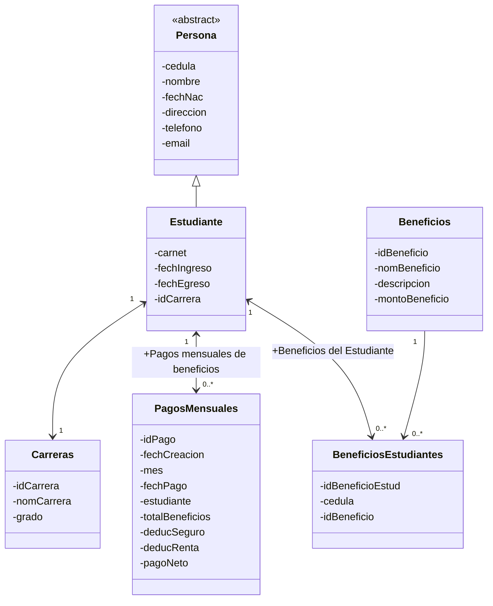

# UNIVERSIDAD TÉCNICA NACIONAL
**INGENIERÍA EN TECNOLOGÍAS DE INFORMACIÓN — SEDE DE GUANACASTE**

# GUÍA DEL PROYECTO II

- **Curso:** Programación II
- **Prof.:** Ing. Jonathan Moreno Núñez
- **Porcentaje:** 15% | **Puntos:** 100
- **Fecha de entrega:** 1 de diciembre 2026, 08:00 am
- *El proyecto se debe realizar en grupos de 2 personas.*

---

## Objetivos del Proyecto

Desarrollar habilidades de trabajo en equipo, documentación y resolución de problemas mediante la creación de una aplicación orientada a objetos para gestionar los beneficios complementarios dirigidos a estudiantes de la Universidad Técnica Nacional. El sistema utilizará Java, la biblioteca gráfica Swing, una base de datos MySQL para almacenar la información y el patrón arquitectónico Modelo-Vista-Controlador (MVC).

## Enunciado del Proyecto

Desarrolle una aplicación en Java que facilite a la Universidad Técnica Nacional el control de los beneficios complementarios dirigidos a sus estudiantes y la gestión del pago mensual de estos beneficios.

La aplicación debe utilizar Swing para la interfaz gráfica y conectarse a una base de datos MySQL para almacenar la información del sistema. Se trabajará con programación orientada a objetos y se aplicará el patrón arquitectónico MVC.

El proyecto se llamará `Proyecto2-Nombre1-Nombre2`. Se deben crear los paquetes necesarios para organizar el código según MVC y utilizar la misma estructura del proyecto de la Clínica que se desarrolló en clase.

---

## Las Clases y Diagrama de Clases

Deben crearse **6 clases JavaClass**: `Persona`, `Estudiante`, `Carreras`, `Beneficios`, `BeneficiosEstudiantes`, `PagosMensuales`.

---

## Requerimientos del Sistema (Atributos por Clase)

### 1. Clase `Persona`
**Descripción:** Almacena la información importante de todos los estudiantes de la UTN. Es una **clase Abstracta**, para heredar a `Estudiante`.

| Campo | Descripción | Observaciones |
| :--- | :--- | :--- |
| `cedula` | Número de cédula de la persona, no pueden haber duplicados de este campo, **es único**. | Debe validar que no se repitan, es `UNIQUE`. |
| `nombre` | Nombre de la persona. | Incluye apellidos. |
| `fechNac` | Fecha de nacimiento de la persona. | Usar tipo de dato de fecha. **Se debe usar un DatePicker**. |
| `direccion` | Dirección de residencia de la persona. | — |
| `telefono` | Número de teléfono de la persona. | **Se debe usar un `JFormattedTextField`** como máscara de entrada de datos. |
| `email` | Dirección de email de la persona. | Debe ser único en la tabla (`UNIQUE`). |

### 2. Clase `Estudiante`
**Descripción:** Almacena la información importante de todos los estudiantes de la UTN. Hereda de la clase `Persona`.

| Campo | Descripción | Observaciones |
| :--- | :--- | :--- |
| `carnet` | Identificación única de cada estudiante en la UTN. No permite duplicados. | Debe validar que no se repitan, es `PK`. |
| `fechIngreso` | Fecha de ingreso a la universidad. | Usar tipo de dato de fecha. **Se debe usar un Calendar / DatePicker**. |
| `fechEgreso` | Fecha de graduación del estudiante. **Puede quedar vacío**. | Usar tipo de dato de fecha. **Se debe usar un DatePicker**. |
| `carrera` (`idCarrera`) | **Id de carrera del estudiante, éste debe existir en la tabla Carreras.** | Nota: Es una clave foránea (`FK`) en la BD. |

### 3. Clase `Carreras`
**Descripción:** Almacena la información referente a las carreras que se ofrecen en la universidad.

| Campo | Descripción | Observaciones |
| :--- | :--- | :--- |
| `idCarrera` | Identificador numérico único para cada carrera de la UTN. | Debe validar que no se repitan, `PK`. |
| `nomCarrera` | Nombre de la carrera. | — |
| `grado` | Grado académico que ofrece la carrera. **Use un comboBox**. | `Diplomado`, `Bachiller`, `Maestría`. |

### 4. Clase `Beneficios`
**Descripción:** Almacena la información referente a todos los beneficios complementarios que la universidad ofrece a los estudiantes.

| Campo | Descripción | Observaciones |
| :--- | :--- | :--- |
| `idBeneficio` | Identificador único para cada beneficio existente en la universidad. | Debe validar que no se repitan, es `PK`. |
| `nomBeneficio` | Nombre del beneficio. | Ejemplos: Beca 1, Ayuda complementaria, Alquiler, otros. |
| `descripcion` | Descripción detallada del beneficio. | — |
| `montoBeneficio` | Monto en colones que se otorga por el beneficio a los estudiantes. | Se usan 2 decimales. |

### 5. Clase `BeneficiosEstudiantes`
**Descripción:** En ella se almacenan los beneficios que son asignados a los estudiantes que cumplan con los requisitos; en base de datos es una tabla intermedia. Tanto la cédula como el id del beneficio se pueden repetir, son llaves foráneas, indicando que un solo estudiante puede tener varios beneficios asignados.

| Campo | Descripción | Observaciones |
| :--- | :--- | :--- |
| `idBeneficioEstud` | Identificador único para cada beneficio asignado a algún estudiante de la UTN. | Es `PK`, sin duplicados. |
| `cedula` | Cédula del estudiante al que se le asignará el beneficio otorgado. | Debe validar que la cédula exista en la tabla `Estudiante`. Es `FK`. |
| `idBeneficio` | Id del beneficio que se asignará al estudiante para ser aplicado. | Debe validar que `idBeneficio` exista en la tabla `Beneficios`. Es `FK`. |

### 6. Clase `PagosMensuales`
**Descripción:** En ella se llevará el registro de todos los pagos mensuales que se le hacen a los estudiantes que cuentan con beneficios complementarios.

| Campo | Descripción | Observaciones |
| :--- | :--- | :--- |
| `idPago` | Número único y consecutivo para identificar cada registro de cada pago mensual efectuado a un estudiante. | Debe validar que los consecutivos no se repitan. Es `PK`. |
| `fechCreacion` | Fecha en la que se crea cada registro de pago. | Se debe tomar la fecha del sistema. Debe usar el tipo de dato fecha. |
| `mes` | Mes que se está pagando. Los pagos se hacen mensualmente. | Se debe desplegar en Texto, ejemplo `Julio`. |
| `fechaPago` (`fechPago`) | Fecha en la que se realizan los pagos. | Debe usar el tipo de dato fecha. |
| `estudiante` | Es la cédula del estudiante a la que se hará el pago, es una clave foránea, debe existir en la tabla `Estudiante`. | Un estudiante podrá tener un pago cada mes, o podría no tener ninguno. |
| `totalBeneficios` | Monto total por concepto de la suma de los beneficios asignados que se pagará al estudiante. | Se suma el monto de cada plus asignado a cada estudiante, según la tabla `BeneficiosEstudiantes`. |
| `deducSeguro` | La deducción del seguro será de un **10%** de la suma de los beneficios del estudiante (`totalBeneficios`). | Se calcula automático. |
| `deducRenta` | La deducción de renta será de un **5%** del total de beneficios. La renta es un impuesto que cobra el gobierno. | Se calcula automático. |
| `pagoNeto` | Monto neto a pagar al estudiante por concepto del total de los beneficios asignados menos la suma de las deducciones de seguro y renta. | Se calcula automático. |

---

## Requerimientos Funcionales y Técnicos

1. **Base de Datos y Entregables Obligatorios:**
   - Basado en el diagrama de clases, cree la base de datos.
   - **Se debe aportar el diagrama relacional de base de datos generado en Workbench y el script de base de datos en un archivo `.sql`. Si no se entrega esto no se revisará el proyecto.**

2. **Interfaz Principal (`JFrame`) y Menús:**
   - La interfaz principal (`JFrame`) debe tener acceso a los módulos del sistema, **tanto por botones en el formulario como por la barra de menú (`JMenuBar`)** como acceso secundario, usando íconos, separadores, *shortcuts* (`Accelerator`), etc.

3. **Arquitectura MVC y Conexión BD:**
   - Crear la conexión y todas las clases necesarias que se comunican con la base de datos según la estructura MVC vista en clase (proyecto Clínica).

4. **Módulos CRUD (`Estudiante`, `Beneficios`, `Carreras`):**
   - Realizar los CRUDs completos: **Insertar, Buscar (filtrado), Modificar, Eliminar, Mostrar/Listar** con la misma estructura del proyecto de clase (ventana principal con barra de búsqueda, botones `Nuevo`, `Editar`, `Eliminar`, tabla y contador de registros; y ventana secundaria de formulario con `Limpiar`, `Guardar`, `Cancelar`).

5. **Módulo `Asignar Beneficios` (`BeneficiosEstudiantes`):**
   - Permitir elegir de una lista de Estudiantes existentes a uno de ellos y seleccionar de la lista de Beneficios existentes para **asignar o quitar** uno o varios beneficios a un mismo estudiante, mostrando en una `JTable` los beneficios ya asignados previamente.
   - **Doble ruta de acceso obligatoria:**
     1. Desde el botón/menú **Asignar Beneficios** en la pantalla principal (`JFrame`), donde se elige libremente al estudiante de la lista.
     2. Desde la pantalla principal de **Estudiantes** (`FrmEstudianteView`), seleccionando un estudiante en la tabla y presionando el botón **Beneficios**, abriendo el diálogo directamente cargado para ese estudiante.

6. **Módulo `Pagos Mensuales` (`PagosMensuales`):**
   - **Panel Generar Pago mensual:**
     - Carga automáticamente del sistema la fecha actual.
     - Se escoge el **mes** y el **año**, y al presionar **Generar**, se inserta **1 registro por cada Estudiante que tenga beneficios asignados**, calculando automáticamente `totalBeneficios`, `deducSeguro` (10%), `deducRenta` (5%) y `pagoNeto` (85%).
     - Se actualizan y muestran todos los pagos generados en la tabla inferior.
     - **Restricciones críticas:**
       - **NO** se puede generar más de 1 vez una planilla para estudiantes en un mismo mes/año.
       - **NO** se puede generar una planilla para una fecha-mes anterior a la del día y mes actual.
   - **Panel Mostrar Pagos de un mes:**
     - Se elige el **mes** y el **año** y se presiona **Mostrar planilla**.
     - Se abre **otra pantalla** (`DlgPlanillasView`) que carga en una tabla todos los registros de esa planilla en el mes y año elegidos, mostrando además un **total general / sumatoria** de los beneficios pagados en esa planilla.
   - **Tabla inferior y Filtrado:**
     - Despliega todos los registros de todas las planillas/pagos realizados.
     - Permite filtrado de datos (búsquedas) por **Estudiante**, **Mes** y **Año** (`JCheckBox`), escribiendo en el cuadro de texto de búsqueda de la derecha.

7. **Controles, Calidad, Git y Documentación:**
   - Llaves primarias únicas validadas (`carnet`, `idPago`, `idBeneficio`, `idCarrera`), además de `cedula` y `email` únicos.
   - Clases POJO con atributos, `set`, `get`, constructores y métodos de clase.
   - Uso de `LGoodDatePicker` para fechas y controles Swing requeridos (`JFormattedTextField` para teléfono, `JComboBox`, `JCheckBox`, etc.).
   - Validaciones completas con `try/catch` para que el programa nunca se caiga.
   - Uso de **Git y GitHub** para control de versiones y trabajo colaborativo.
   - Código indentado y documentado; **generar y anexar el JavaDoc**.

---

## Precauciones y Notas

- Si se hace caso omiso a los puntos obligatorios (Swing, MySQL, POO, MVC, buenas prácticas), la nota será automáticamente de cero.
- No se aceptarán proyectos fuera de la fecha/hora establecida (subir al campus virtual antes del límite; una vez entregado no se permiten modificaciones).
- Proyectos iguales o similares, o realizados íntegramente sin dominio propio, obtendrán nota cero.
- **El proyecto se debe defender individualmente en clases** en la fecha estipulada.

---

## Rúbrica de Evaluación

| Funcionalidad | Puntos |
| :--- | :---: |
| Uso de BD y script de BD, diagrama relacional | 8 |
| Programación Orientada a objetos | 8 |
| CRUD de Estudiante | 8 |
| CRUD de Carreras | 7 |
| CRUD de Beneficios | 7 |
| Asignar Beneficios | 8 |
| Módulo de pagos mensuales | 10 |
| Interfaz de usuario y uso (interfaz gráfica) | 9 |
| Validaciones | 5 |
| Documentación del código (incluye JavaDoc) | 5 |
| Indentación del código y nombre de variables | 5 |
| Defensa individual del proyecto | 20 |
| **TOTAL DE PUNTOS** | **100** |
